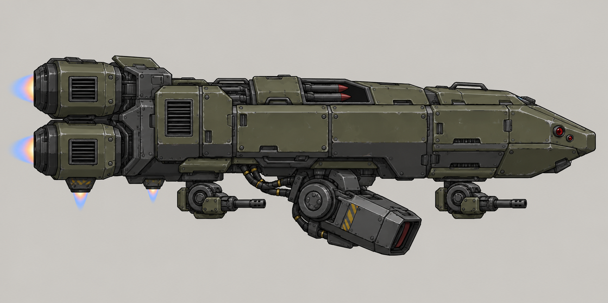
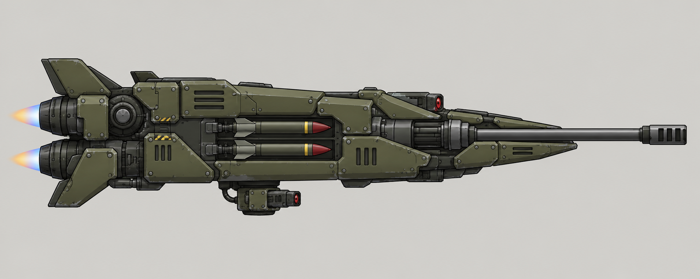

# Воздушные роботы II тира — два визуальных концепта

25 октября 2026 года автор попросил два концепта на основе материалов в папке
референсов. Для пары выбраны существующие роли из
[утверждённого состава](../../APPROVED_CONCEPTS.md): «Архангел» и «Копьё».
Это новые предложения внешнего вида; выбор автора ещё не получен.

## 1. Архангел II

Тяжёлый воздушный крейсер: массивный бронекорпус, центральный нижний осадный
лазер, две отдельные автопушки и утопленная верхняя ракетная кассета.
Крупные задние двигатели и нижние сопла подчёркивают тяжёлое зависание.
Существующая роль — поддержка наступления со стабилизацией перед лазерным огнём.

## 2. Копьё II

Узкий вытянутый охотник на крупные воздушные машины. Главная бронебойная пушка
встроена по продольной оси носа; тяжёлые ракеты размещены вдоль корпуса,
небольшой защитный лазер — в отдельной нижней установке. Выраженные кормовые
двигатели и клиновидный нос подчёркивают лобовую атаку и зависимость от разворота.

## Общая стилистика

Просмотрены три исходных концепта Dynamit Bot, выбранные мина и бункер инженера,
их листы оружия, боеприпасов и анимаций; учтены выбранный Шершень и Бастион V3.
Общие приёмы: оливково-серые панели, тёмная сталь, крупные механические крепления,
чёткий контур, сдержанные потёртости, красная оптика и небольшие предупреждающие
акценты. Оранжевый заряд подрывника не переносится на воздушные машины.
У обеих машин строгий боковой силуэт с носом вправо и разные пропорции.

Создано imagegen по текстовому описанию визуальных приёмов. Исходные рисунки
и игровые спрайты не вклеивались в результат. Полные запросы — [PROMPTS.md](PROMPTS.md),
размеры и SHA-256 — [manifest.json](manifest.json).

Это иллюстрации для выбора облика на светлом фоне, не игровые спрайты или
анимации. Параметры, код и установленная версия мода этим изменением не меняются.
