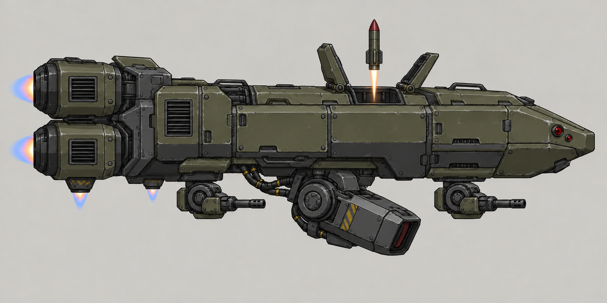
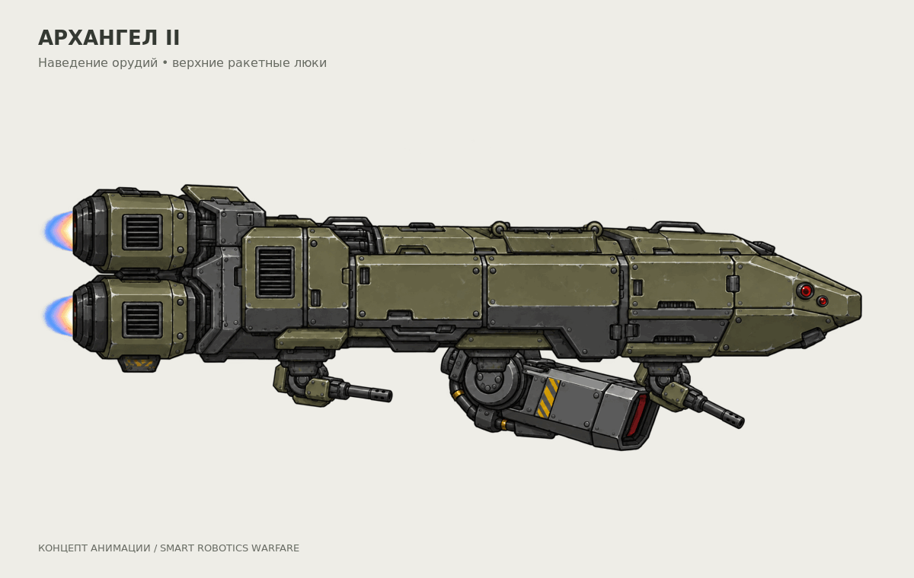
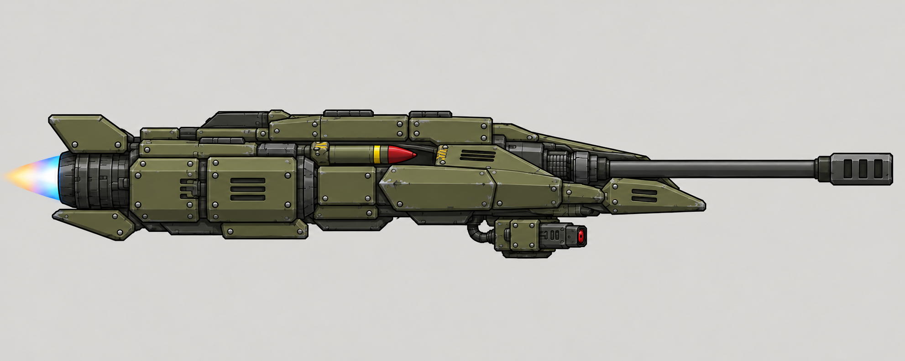
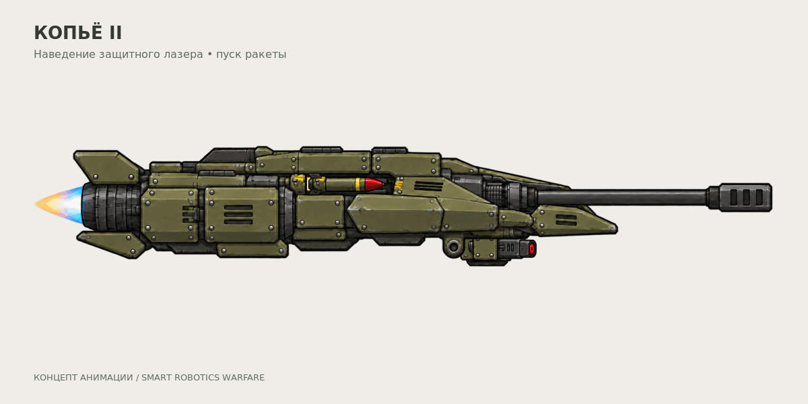

# Воздушные роботы II тира — два визуальных концепта

25 октября 2026 года автор попросил два концепта на основе материалов в папке
референсов. Для пары выбраны существующие роли из
[утверждённого состава](../../APPROVED_CONCEPTS.md): «Архангел» и «Копьё».
Автор выбрал развитие «Архангела» с верхними открывающимися ракетными люками.
Для нового «Копья» выбрано направление: широкий корпус и два боковых двигателя.
Ниже — «Архангел» V2 и «Копьё» V3. По уточнению автора от 26 октября «Копьё»
перерисовано строго сбоку, как модель для двухмерной игры. Автор принял
боковой рисунок «Копья» и попросил GIF нижнего орудия с пуском ракеты.

## 1. Архангел II

Тяжёлый воздушный крейсер: массивный бронекорпус, центральный нижний осадный
лазер, две отдельные автопушки и внутренняя верхняя ракетная шахта.
Перед вертикальным пуском открываются две броневые створки на шарнирах.
Крупные задние двигатели и нижние сопла подчёркивают тяжёлое зависание.
Существующая роль — поддержка наступления со стабилизацией перед лазерным огнём.

### GIF: наведение и вертикальный пуск

Цикл 8 секунд, 160 кадров, 20 кадров/с, 1200×760. Три орудия независимо
поворачиваются вокруг закреплённых шарниров; створки открываются, ракета
выходит вверх из шахты, затем створки закрываются. Корпус остаётся неподвижным.
Это демонстрация предполагаемой механики, а не запись из Forts. Углы и время
цикла иллюстративные: они не задают боевые параметры.

[Детали на прозрачном фоне](animation/archangel-ii-parts-v2.png) нарисованы imagegen,
GIF собран из них через ImageMagick с фиксированными точками крепления.
Воспроизведение: `python docs/concepts/air-tier-2/animation/render_preview.py`
(Python 3, ImageMagick 7 и шрифт DejaVu Sans).
[Контрольные кадры](animation/archangel-ii-v2-contact.png).

## 2. Копьё II

Широкий бронированный охотник на крупные воздушные машины. Две крупные
двигательные гондолы расположены по бокам корпуса на коротких усиленных
креплениях. Длинная бронебойная пушка встроена по продольной оси носа;
тяжёлые ракеты размещены в защищённых нишах по обе стороны от неё,
небольшой защитный лазер — в отдельной нижней установке. Модель показана
строго сбоку, носом вправо. Ближняя двигательная гондола закрывает дальнюю:
это проекция двух боковых двигателей, а не замена их одним.

### GIF: нижнее орудие и пуск ракеты

Нижний модуль — защитный лазер из утверждённой роли №26. В демонстрации
он поворачивается на закреплённом шарнире от горизонтального положения до
60° вниз и обратно. Корпус, двигатель и носовая бронебойная пушка неподвижны.
Одна ракета выходит из боковой ниши, освобождает пространство над корпусом
и уходит вперёд; в конце цикла показана подача следующей ракеты в нишу.

Цикл 8 секунд, 160 исходных кадров при 20 кадрах/с, 1200×600. Углы, время,
траектория выхода из крепления и подача следующей ракеты иллюстративные,
не игровые параметры. Это концептуальная GIF, не запись из Forts.

[Лист деталей](animation/spear-ii-parts-v3.png) подготовлен imagegen;
[первый лист только с отделённым орудием](animation/spear-ii-parts-turret-only.png)
сохранён для истории. Воспроизведение через Python 3 и ImageMagick 7:
`python docs/concepts/air-tier-2/animation/render_spear_preview.py`.
[Контрольные кадры](animation/spear-ii-v3-contact.png).

## Общая стилистика

Просмотрены три исходных концепта Dynamit Bot, выбранные мина и бункер инженера,
их листы оружия, боеприпасов и анимаций; учтены выбранный Шершень и Бастион V3.
Общие приёмы: оливково-серые панели, тёмная сталь, крупные механические крепления,
чёткий контур, сдержанные потёртости, красная оптика и небольшие предупреждающие
акценты. Оранжевый заряд подрывника не переносится на воздушные машины.
Оба актуальных концепта показаны сбоку. Пропорции и роли различаются.

V1 созданы imagegen по текстовому описанию визуальных приёмов, V2 — редактированием
соответствующих V1. «Копьё» V3 получено редактированием V2 с уточнением боковой
проекции по V1. Полные запросы — [PROMPTS.md](PROMPTS.md),
размеры и SHA-256 — [manifest.json](manifest.json).

Это иллюстрации и GIF для выбора облика и движений. Подключение к игровым спрайтам
и проверка в Forts пока не выполнены; установленная версия мода не меняется.

## Предыдущие варианты

- [Архангел V1](images/archangel-ii-v1.png) — исходная открытая ракетная кассета.
- [Копьё V1](images/spear-ii-v1.png) — исходный узкий корпус с кормовыми двигателями.
- [Копьё V2](images/spear-ii-v2.png) — широкий корпус в ракурсе три четверти; автор попросил заменить ракурс боковым.
- [Промежуточный боковой эскиз V3](images/spear-ii-v3-side-study.png) — ещё видна верхняя плоскость; уточнён в основном V3.
