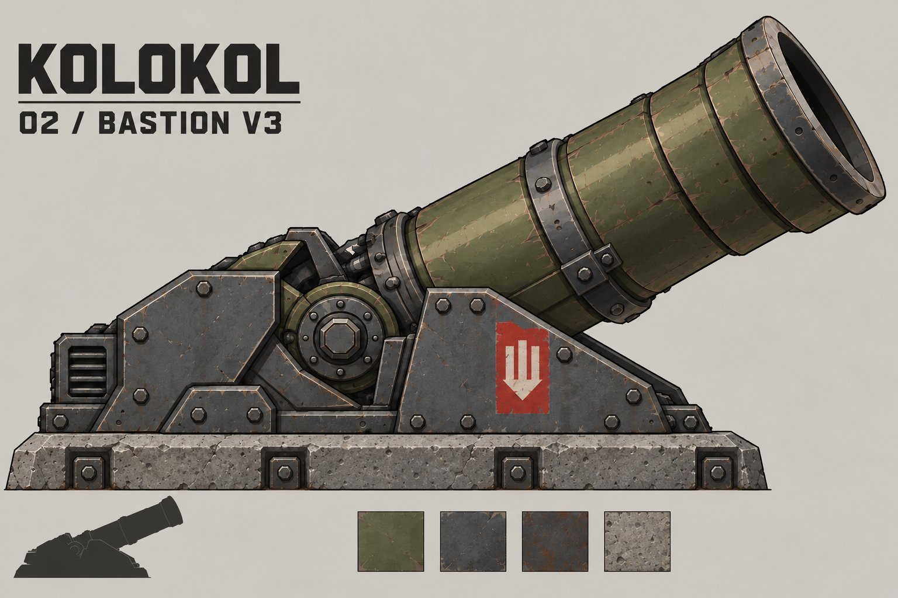
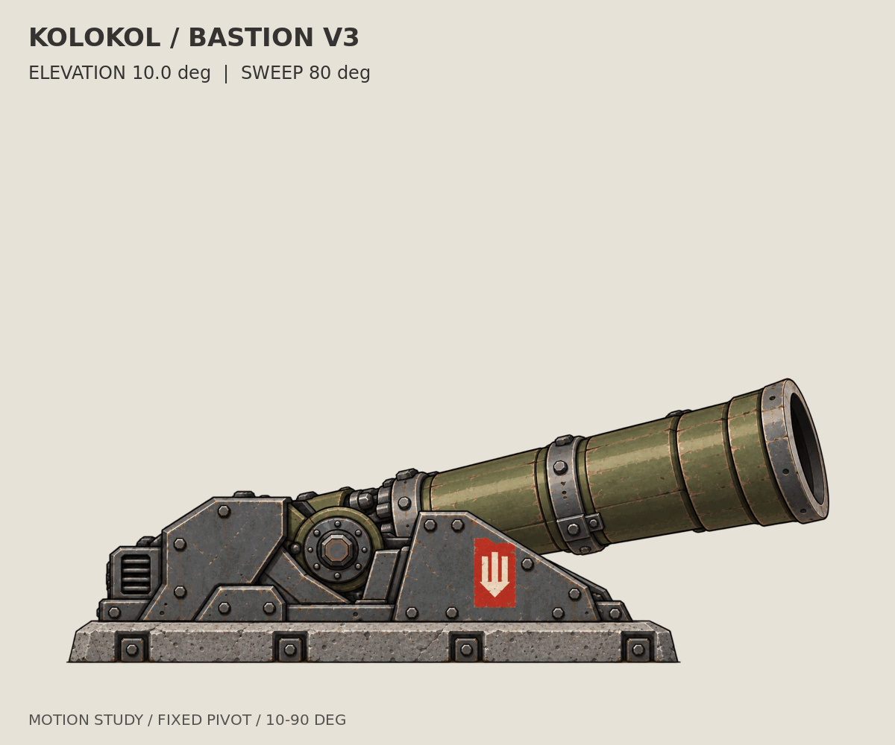
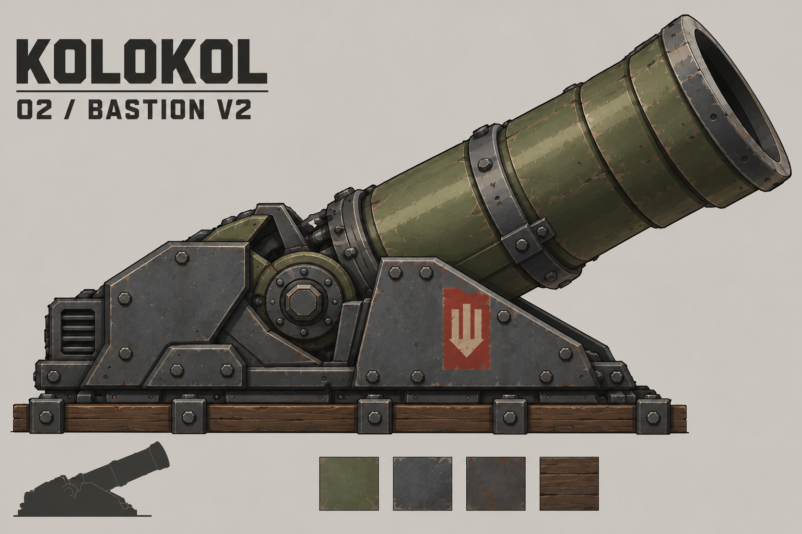
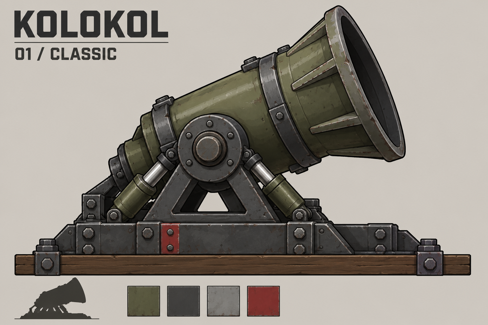
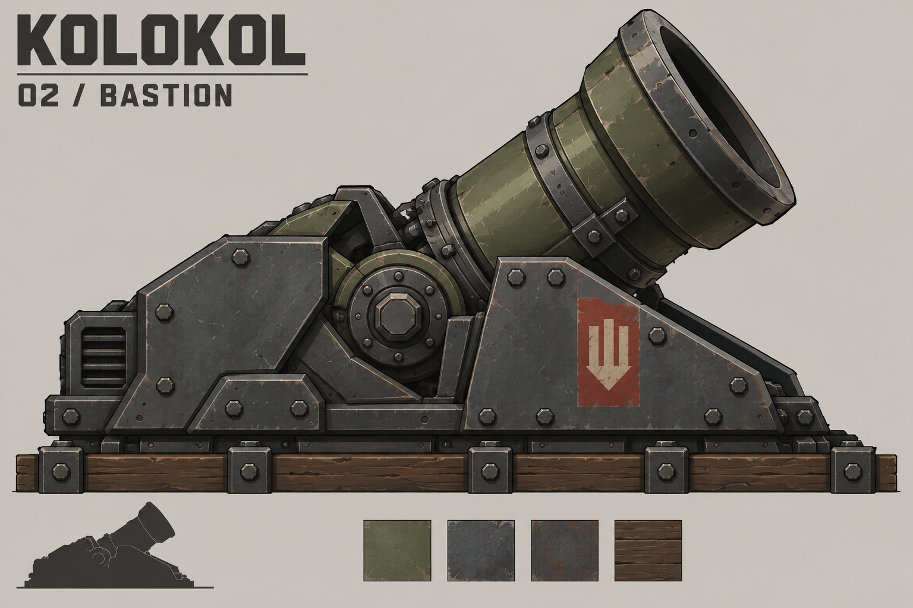
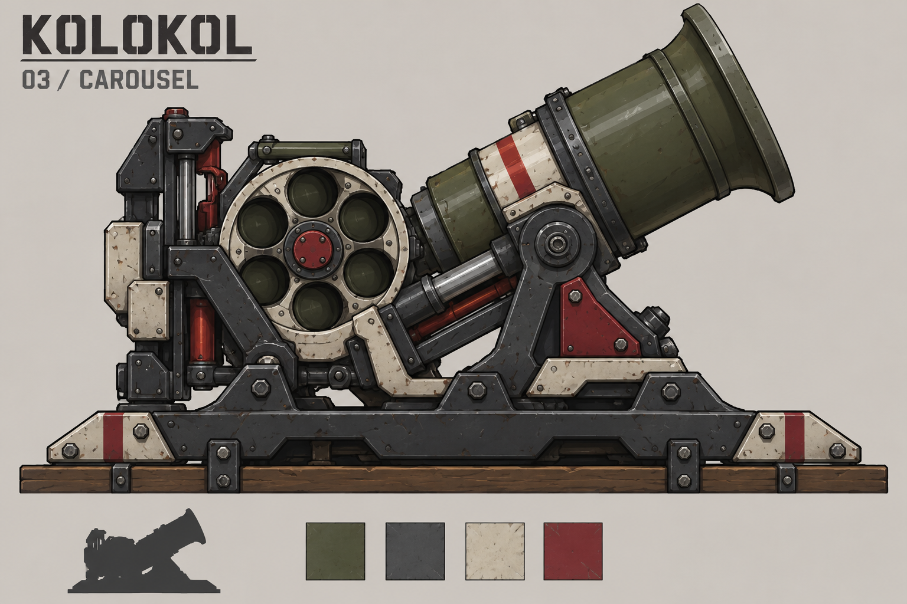
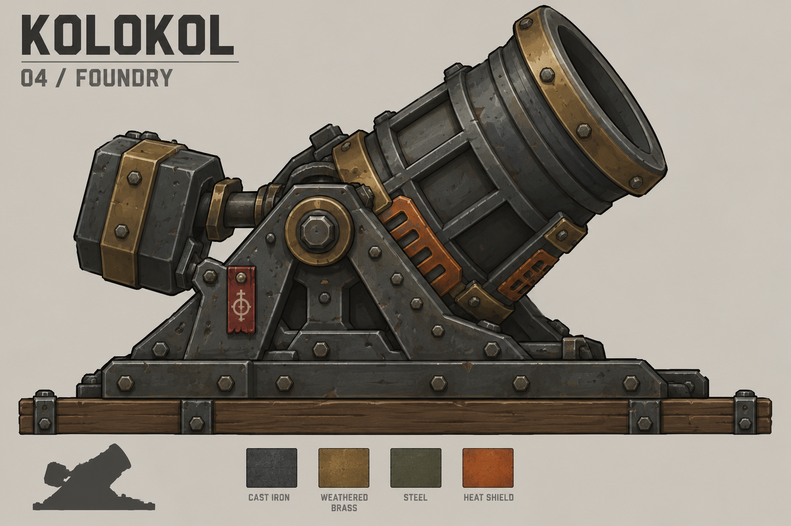
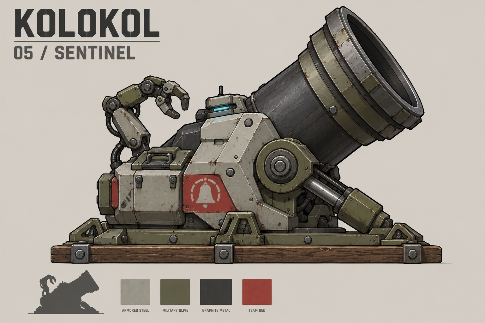

# Осадная мортира «Колокол» — концепты и выбранный «Бастион»

Дата: 23 октября 2026 года. Проект: Smart Robotics Warfare / Forts.

Пять отдельных изображений исследуют внешний вид одной стационарной осадной мортиры. Это сгенерированные концепт-арты, а не готовые текстуры, спрайт-листы или утверждённые игровые характеристики. Исходная модель и описание существующего «Колокола» на момент работы недоступны; размеры, точки крепления и пропорции пока предложены заново. Совпадение с текущим оружием в моде не проверено.

Основа исследования — официальные материалы Forts и Moonshot, публичные описания и доступные превью нескольких оружейных модов. Список выбранных источников и границы исследования приведены в [SOURCES.md](SOURCES.md). Это выборка, а не обзор всех модов Forts.

## Выбранное направление: «Бастион»

Пользователь выбрал вариант 02 «Бастион» для дальнейшей разработки. Текущая доработка — V3: удлинённый широкий ствол V2 сохранён, нижняя опора заменена бетонной плитой.

### Превью поворота ствола на 80°

Поворот от 10° до 90° и обратно вокруг шарнира, корпус неподвижен. [Описание и исходные слои GIF](animation/README.md).

### Турельный снаряд

Выбрана «Матрёшка». [GIF полёта капсулы и раскрытия в турель](turret-pods/flight-animation/README.md).

[Пять концептов раскрывающегося турельного снаряда](turret-pods/README.md): «Бутон», «Матрёшка», «Паук», «Тренога» и «Панцирь». Каждый показан в трёх стадиях.

### Предыдущая ревизия V2

Запрос правки: увеличить длину ствола примерно в полтора раза и его диаметр примерно на четверть, сохранив дизайн бронированного основания. Это художественные ориентиры генерации; точные геометрические размеры не измерялись. Пропорции исходного корпуса могут немного отличаться из-за генеративной правки. Изображение остаётся статичным концептом, а не игровой текстурой.

[Исходный «Бастион» для сравнения](images/02_bastion.png). Пять первоначальных вариантов сохранены ниже как история выбора.

## Галерея первоначальных вариантов

### 01 — Классика / Classic

Литой оливковый ствол, открытая цапфа, треугольная опора и короткие цилиндры отката. Наиболее простой и близкий к базовому индустриальному направлению Forts вариант. Основные материалы: окрашенная сталь и тёмный металл, небольшой красный элемент командного цвета.

Для последующей анимации: отдельно подготовить ствол, люльку, цилиндры и неподвижное основание. Визуальная идея — короткий откат с возвратом; конкретное движение требует проверки в игре.

### 02 — Бастион / Bastion

Низкий угловатый бронекожух защищает казённую часть; крупный короткий ствол выступает над ним. Самый плотный и защищённый силуэт. Материалы: тёмная броневая сталь, оливковый ствол, красная опознавательная панель.

Для последующей анимации: отделить неподвижные бронещёки от люльки и ствола; предусмотреть свободное пространство для отката. Видимая броня — художественное решение, значение прочности не задано.

### 03 — Карусель / Carousel

Выраженный барабан позади казённой части и открытый механизм подачи создают образ мортиры с автоматизированным заряжанием. Отличается прежде всего компоновкой, а не цветом. Материалы: тёмная механика, светлые панели, оливковый ствол.

Для последующей анимации: барабан, подачу, казённик и ствол подготовить отдельными слоями. Вращение барабана и цикл заряжания — предложения для будущего визуального прототипа; скорострельность и ёмкость магазина не утверждены.

### 04 — Литейная / Foundry

Самая буквальная интерпретация имени: выраженный колоколообразный дульный обод, тяжёлая литая конструкция, рёбра и широкие клёпаные опоры. Материалы: тёмный чугун, приглушённые латунные детали и охристые защитные накладки.

Для последующей анимации: разделить ствол, боковые опоры, противовес и основание. Чувство массы передавать коротким откатом и плавным возвратом; визуальные эффекты нагрева можно исследовать отдельно.

### 05 — Страж / Sentinel

Роботизированная версия для названия Smart Robotics Warfare: светлые гранёные панели, тёмный массивный ствол, небольшой датчик и компактный манипулятор у зоны заряжания. Материалы: графитовый металл, светло-серая броня, красная командная панель и сдержанный голубой индикатор.

Для последующей анимации: манипулятор, захват, датчик, затвор и ствол подготовить отдельно. Манипулятор в этой работе — визуальная идея; никакой скрипт управления или дополнительная игровая механика не реализованы.

## Общие ориентиры для следующего этапа

- Сохранять читаемый силуэт сбоку, широкий короткий ствол, крупный дульный обод и устойчивое стационарное основание.
- Выбрать один вариант и сверить его с реальной геометрией, масштабом и сектором наведения существующего оружия.
- Рисовать чистовой спрайт без фона и подписей; разделить подвижные части, назначить точки вращения и крепления по игровому скрипту.
- Уменьшить детали до игрового размера и проверить читаемость на фоне конструкции форта.
- После появления возможности запустить Forts проверить наведение, откат, загрузку текстур и сетевое поведение.

Изображения имеют фон и презентационные элементы. Это материалы для выбора направления, они не предназначены для прямой подстановки вместо игровых текстур. Оружие и анимация в Forts не тестировались.

## Состав набора

- `images/01_classic.png` … `images/05_sentinel.png` — пять первоначальных изображений.
- `images/02_bastion_v2.png` — предыдущая ревизия с увеличенным стволом.
- `images/02_bastion_v3.png` — текущая ревизия с бетонной плитой.
- `animation/` — GIF поворота на 80°, слои и скрипт сборки.
- `turret-pods/` — пять концептов турельного снаряда.
- [SOURCES.md](SOURCES.md) — источники и связь с исследованием.
- [PROMPTS.md](PROMPTS.md) — использованные запросы генерации.
- [manifest.json](manifest.json) — размеры, контрольные суммы и перечень файлов.

Генерация: OpenAI image generation. В репозиторий добавлены собственные сгенерированные изображения и заметки; исходные игровые и чужие модовые ассеты в набор не включены.
