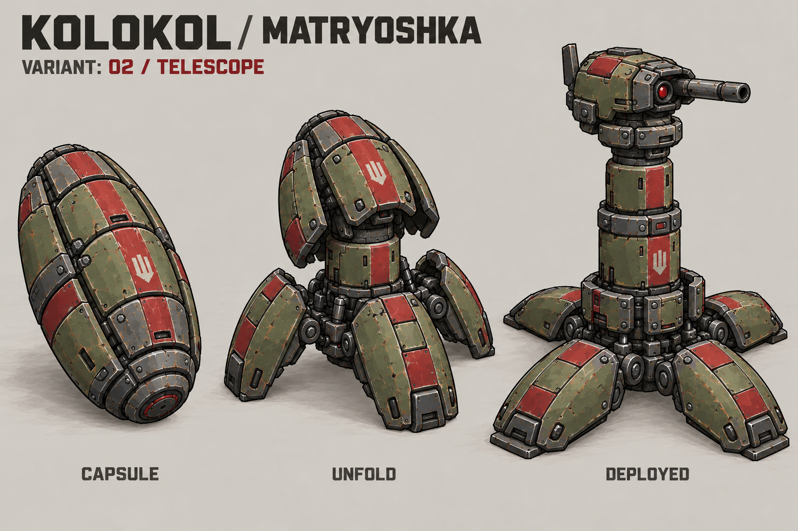

# Турельный снаряд «Колокола» — «Матрёшка V2»

Пользователь выбрал «Матрёшку». Текущая предлагаемая ревизия **02 / TELESCOPE V2** переносит на неё визуальный стиль «Колокола — Бастиона»: потёртую оливковую краску, тёмную сталь, крупные болты, грубую броню и плоскую красную маркировку. Это новый концепт для рассмотрения, а не утверждённый игровой спрайт.

## Обновлённый концепт

Отсылка к чемодану Тони Старка относится к **последовательности трансформации**. Панели маленькой капсулы становятся опорами, вложенные секции выдвигаются, сложенная головка поднимается и разворачивается. Цвета и материалы взяты у «Колокола», а не у супергеройского костюма. [Художественное задание](MATRYOSHKA_V2_BRIEF.md).

## GIF: полёт и раскрытие V2

[Описание и исходники V2](flight-animation-v2/README.md). В GIF панели раскрываются с задержкой друг за другом, секции поднимаются последовательно, затем головка поворачивается в рабочее положение. Это художественная демонстрация, в Forts она не тестировалась.

[Прежняя светлая версия GIF](flight-animation/README.md) сохранена как история. [Манифест набора](manifest.json).

## Пять первоначальных вариантов

Ниже — исходные варианты до выбора «Матрёшки» и переноса стиля «Колокола».

## 01 / BUD — «Бутон»

Продольные панели капсулы раскрываются лепестками и становятся широкими опорами. Центральная стойка поднимает турель.

## 02 / TELESCOPE — «Матрёшка»

Светлая капсула раскрывается в низкую опорную площадку. Вложенные сегменты корпуса поднимаются телескопической колонной с головкой наверху.

## 03 / SPIDER — «Паук»

Четыре сегмента оболочки становятся шарнирными лапами. Турель остаётся низкой и широкой, с корпусом над поверхностью.

## 04 / TRIPOD — «Тренога»

Три длинные панели разворачиваются в высокие опоры. Центральный корпус превращается в головку на вершине штатива.

## 05 / SHELL — «Панцирь»

Панели образуют защитную броневую юбку. Сверху лишь немного поднимается компактная головка; силуэт самый приземистый.

## Общая идея развёртывания

1. В полёте предмет остаётся компактной закрытой капсулой.
2. После контакта с землёй капсула фиксируется и раскрывает опорные панели.
3. Центральный модуль поднимается, головка занимает рабочее положение.
4. Развёрнутая турель становится игровым объектом стороны, выпустившей снаряд.

Это описание желаемого поведения. Обнаружение поверхности, сохранение владельца, игровой объект турели, её оружие, время жизни, лимиты, баланс и сетевое поведение пока не реализованы. Концепты не задают размеры, дальность, урон или скорострельность. Точное совпадение деталей и объёма между стадиями требует ручной подготовки чистовых спрайтов.

Исходные файлы: [PROMPTS.md](PROMPTS.md), [manifest.json](manifest.json). [Вернуться к «Колоколу»](../README.md).
