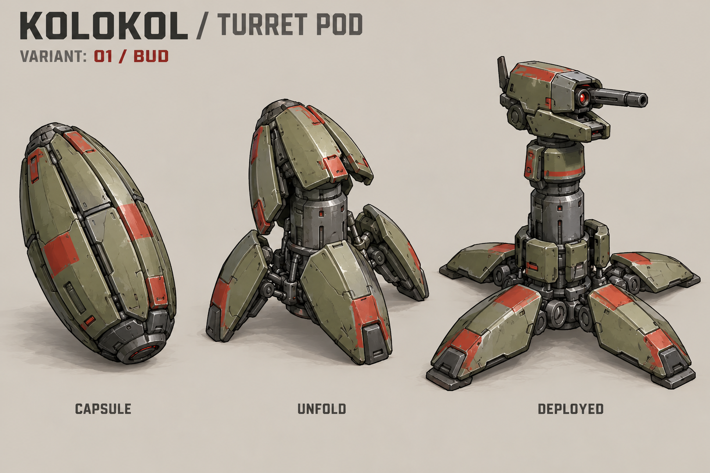
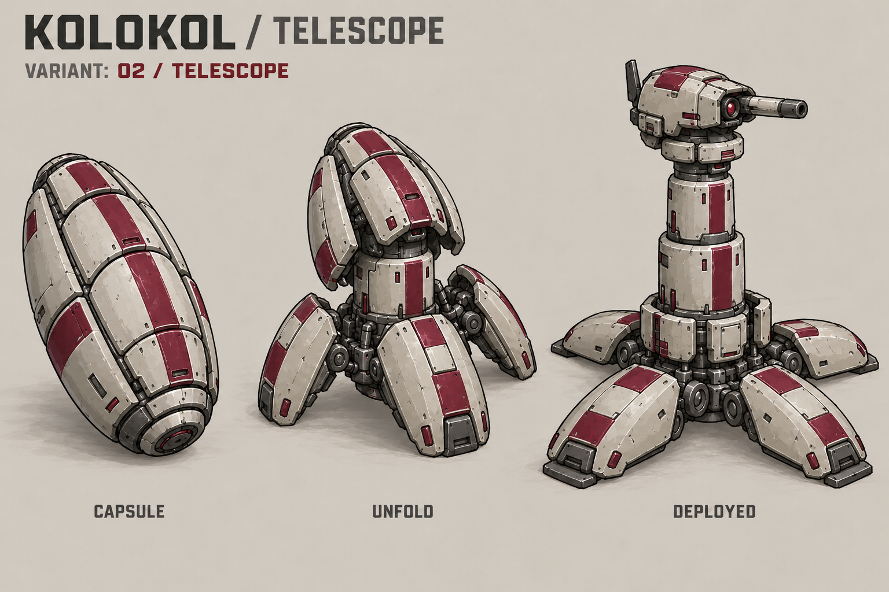
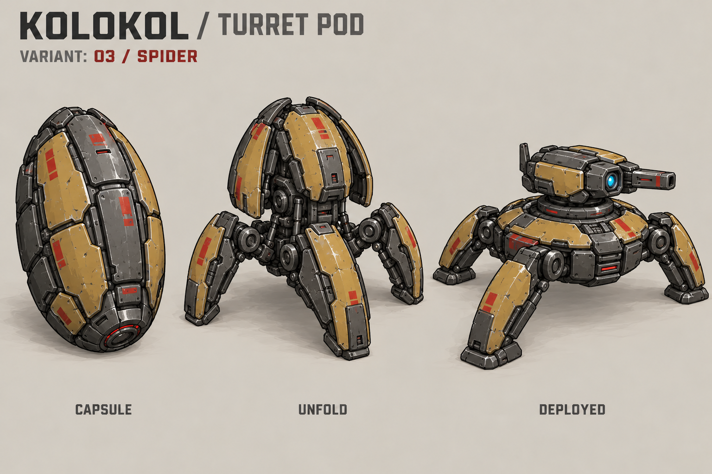
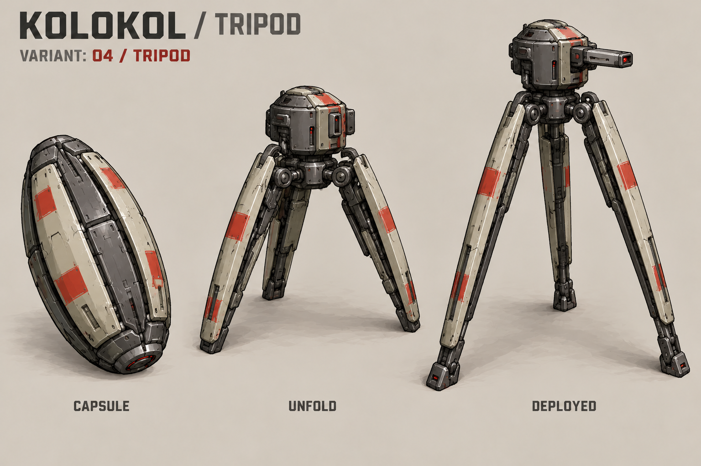
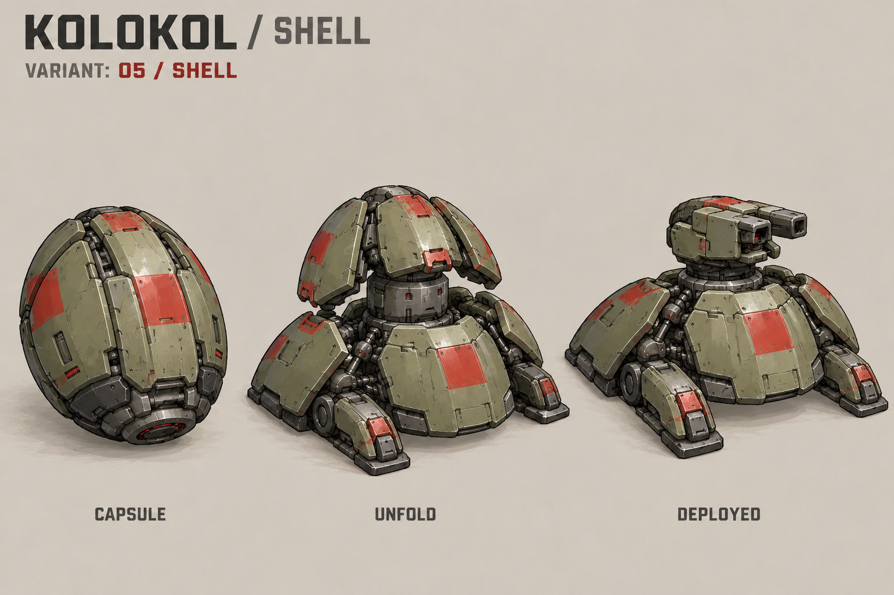

# Турельный снаряд «Колокола» — пять концептов

Дата: 23 октября 2026 года. Набор исследует особый снаряд-капсулу для Smart Robotics Warfare: после контакта с землёй оболочка раскладывается в опоры, а центральный модуль становится турелью. На каждом листе показаны **CAPSULE → UNFOLD → DEPLOYED**. Это статичные художественные стадии, а не готовая анимация трансформации.

Пожелания пользователя: компактная упаковка и последовательное раскрытие панелей, по аналогии с впечатлением от костюма-чемодана Тони Старка и турели инженера из Deep Rock Galactic. Дизайн деталей, окраска и компоновка здесь предложены заново. Готовые ассеты этих произведений не использовались.

## GIF: полёт и раскрытие

[Описание, стадии и исходники анимации](flight-animation/README.md). Это превью исходной выбранной «Матрёшки»; индустриальная версия V2 пока остаётся заданием на доработку.

## Выбранное направление — «Матрёшка»

Пользователь выбрал **02 / TELESCOPE**. Следующая доработка — менее высокотехнологичная версия с простыми стальными панелями, крупными болтами и шарнирами, вложенной механической стойкой и без светящихся деталей. [Художественное задание V2](MATRYOSHKA_V2_BRIEF.md). Изображение V2 пока не получено; ниже показаны первоначальные концепты.

## 01 / BUD — «Бутон»

Продольные панели капсулы раскрываются лепестками и становятся широкими опорами. Центральная стойка поднимает турель.

## 02 / TELESCOPE — «Матрёшка»

Светлая капсула раскрывается в низкую опорную площадку. Вложенные сегменты корпуса поднимаются телескопической колонной с головкой наверху.

## 03 / SPIDER — «Паук»

Четыре сегмента оболочки становятся шарнирными лапами. Турель остаётся низкой и широкой, с корпусом над поверхностью.

## 04 / TRIPOD — «Тренога»

Три длинные панели разворачиваются в высокие опоры. Центральный корпус превращается в головку на вершине штатива.

## 05 / SHELL — «Панцирь»

Панели образуют защитную броневую юбку. Сверху лишь немного поднимается компактная головка; силуэт самый приземистый.

## Общая идея развёртывания

1. В полёте предмет остаётся компактной закрытой капсулой.
2. После контакта с землёй капсула фиксируется и раскрывает опорные панели.
3. Центральный модуль поднимается, головка занимает рабочее положение.
4. Развёрнутая турель становится игровым объектом стороны, выпустившей снаряд.

Это описание желаемого поведения. Обнаружение поверхности, сохранение владельца, игровой объект турели, её оружие, время жизни, лимиты, баланс и сетевое поведение пока не реализованы. Концепты не задают размеры, дальность, урон или скорострельность. Точное совпадение деталей и объёма между стадиями требует ручной подготовки чистовых спрайтов.

Исходные файлы: [PROMPTS.md](PROMPTS.md), [manifest.json](manifest.json). [Вернуться к «Колоколу»](../README.md).
