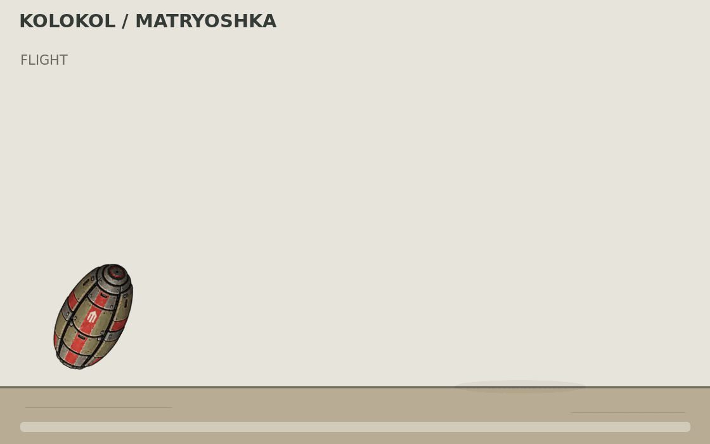

# «Матрёшка V2» — полёт и складное раскрытие



**1120×700, 140 кадров, 20 кадров/с, 7 секунд**, зацикленный GIF.

1. **Полёт — 2,4 с.** Небольшая капсула летит по дуге и поворачивается по направлению движения.
2. **Приземление — 0,4 с.** Контакт с поверхностью и выпрямление.
3. **Опоры — 1,2 с.** Панели раскрываются на шарнирах с небольшой задержкой друг за другом.
4. **Рост турели — 1,2 с.** Выдвигаются вложенные секции; сложенная головка в конце подъёма поворачивается в рабочее положение.
5. **Показ — 1,4 с.** Пауза с развёрнутой турелью.
6. **Переход к следующему циклу — 0,4 с.**

[Ключевые стадии](keyframes.png) · [Развёрнутая турель](deployed_preview.png).

## Внешний вид и трансформация

Референс оформления — «Колокол — Бастион»: олива, тёмная сталь, крупные болты и красные панели. От чемодана Старка заимствован принцип последовательного раскладывания. В анимационных слоях светящийся элемент на головке заменён металлической крышкой; детали этих слоёв могут немного отличаться от концепт-листа.

Капсула, опоры, секции и головка собраны из отдельных сгенерированных деталей. Начало раскрытия использует короткое смешивание цельной капсулы и отдельных панелей; затем части движутся независимо. Дуга, масштаб, шарниры и тайминги заданы для художественного превью и не подтверждают реальную кинематику или игровую реализацию.

Это вариант для рассмотрения пользователем. Полёт, поверхность, владелец, урон, создание турели, её баланс и сетевое поведение в игре не реализованы и не проверены.

## Исходники

- `layers.png` — сгенерированный лист восьми деталей.
- `sprites/` — детали, выделенные для сборки GIF.
- `render.mjs` — воспроизводимая сборка с Node.js и ImageMagick 7.
- `motion.json` — последовательность кадров и фазы.
- [PROMPTS.md](PROMPTS.md) — успешные запросы генерации.
- [manifest.json](manifest.json) — контрольные суммы и параметры.

```sh
node render.mjs /tmp/matryoshka-olive-v2-frames
```

[Концепт V2](../images/02_telescope_v2.png) · [Вернуться к галерее](../README.md) · [Предыдущий GIF](../flight-animation/README.md).
