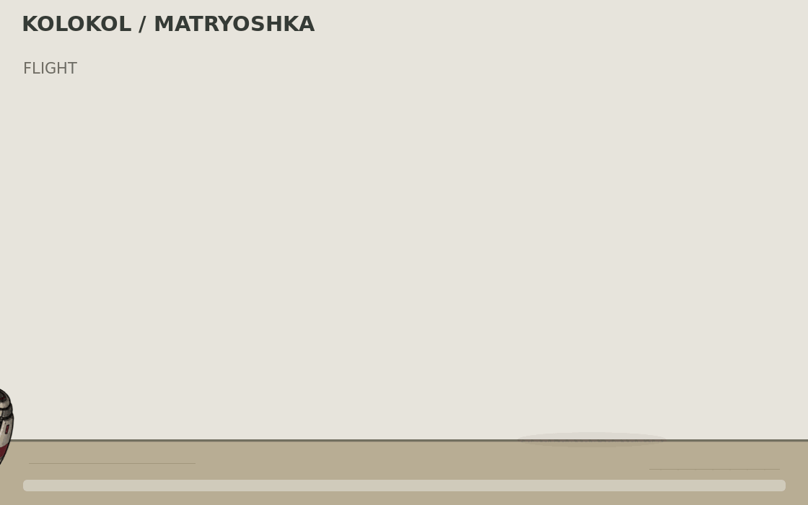

# «Матрёшка» — полёт и раскрытие в турель

**Историческая версия.** Подготовлена [новая оливковая V2 в стиле «Колокола»](../flight-animation-v2/README.md), с последовательным раскрытием панелей, подъёмом секций и поворотом головки. Ниже сохранён прежний светлый вариант.

**Статус: предварительное превью прежнего светлого концепта.** Требуемый стиль снаряда — как у «Колокола — Бастиона», а раскрытие должно последовательно превращать компактную капсулу в турель. [Уточнённое задание](../MATRYOSHKA_V2_BRIEF.md). Эта GIF ещё не реализует исправленное визуальное направление.



**1120×700, 140 кадров, 20 кадров/с, 7 секунд**, зацикленный GIF.

1. **Полёт — 2,4 с:** закрытая капсула движется по дуге, её нос поворачивается по направлению движения.
2. **Приземление — 0,4 с:** контакт с поверхностью, небольшой отскок и выпрямление.
3. **Раскрытие — 1,2 с:** боковые панели поворачиваются наружу вокруг нижних креплений и образуют опоры.
4. **Подъём — 1,2 с:** секции телескопической стойки поднимаются последовательно, вместе с головкой турели.
5. **Показ турели — 1,4 с:** пауза в полностью развёрнутом состоянии.
6. **Переход к следующему циклу — 0,4 с.**

[Четыре ключевых положения](keyframes.png) · [Развёрнутая турель](deployed_preview.png).

## Основа и ограничения

Анимация использует выбранную **исходную «Матрёшку» 02 / TELESCOPE** со светлой оболочкой и бордовыми полосами. Индустриальная версия V2 теперь представлена отдельно; эта историческая анимация сохраняет первоначальный внешний вид.

Детали заново подготовлены генератором по первоначальному листу. Это условное художественное движение: форма и пропорции отдельных деталей могут отличаться от исходного концепта; переход от цельной капсулы к отдельным панелям слегка смешивается в начале раскрытия. Дальше панели поворачиваются и секции стойки перемещаются отдельно — это не просто смена трёх готовых картинок.

Дуга и тайминги выбраны для демонстрации. Они не задают баллистику, реальные конструктивные решения или игровые характеристики. Урон, взаимодействие с землёй, создание турели, принадлежность игроку и сетевое поведение в Forts не реализованы и в игре не проверялись.

## Исходники

- `layers.png` — сгенерированный лист восьми отдельных деталей.
- `sprites/` — выделенные и масштабированные детали для этой анимации.
- `motion.json` — фазы, координаты и последовательность кадров.
- `render.mjs` — повторная сборка с Node.js и ImageMagick 7.
- [PROMPT.md](PROMPT.md) — запрос подготовки деталей.
- [manifest.json](manifest.json) — перечень файлов и контрольные суммы.

```sh
node render.mjs /tmp/matryoshka-flight-frames
```

[Вернуться к концептам снаряда](../README.md).
